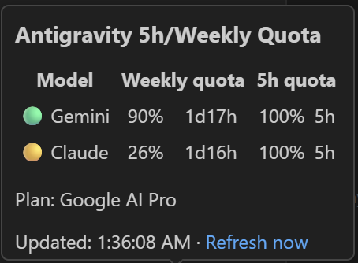

# Antigravity 5h/Weekly Quota

A lightweight VS Code extension that displays Google Antigravity five-hour and weekly quota in the status bar.



## Status bar

> 🟢 Gemini 90% 1d17h · 🟢 100% 5h ║ 🟡 Claude 26% 1d17h · 🟢 100% 5h

Each model group shows its weekly quota first and its five-hour quota second. A light `·` separates quota windows within a model, while `║` separates Gemini from Claude.

Indicator colors are based on the remaining quota:

- 🟢 Green: above 50%
- 🟡 Yellow: above 20% through 50%
- 🔴 Red: 0% through 20%

## Features

- Displays Gemini and Claude/GPT weekly and five-hour quota.
- Shows compact reset countdowns such as `4h59min` and `1d17h`.
- Provides a hover table with grouped `Weekly quota` and `5h quota` columns.
- Refreshes automatically and supports manual refresh from the hover panel or Command Palette.
- Reuses the existing Antigravity CLI sign-in without writing the CLI credential to disk.

## Requirements

- Windows
- Visual Studio Code 1.90 or later, or a compatible Antigravity IDE build
- Antigravity CLI (`agy`) installed
- At least one successful `agy` sign-in

## Installation

### Install a VSIX

1. Download the latest `.vsix` from this repository's Releases page when available.
2. Open the Extensions view in VS Code or Antigravity IDE.
3. Select **Views and More Actions** (`...`) → **Install from VSIX...**.
4. Select the downloaded file and reload the window.

### Run from source

1. Clone this repository.
2. Open it in VS Code.
3. Press `F5` to launch an Extension Development Host.

## Usage

- Hover over the status item to view the grouped quota table, current plan, update time, and refresh link.
- Click the status item to open a detailed quota list.
- Run **Antigravity 5h/Weekly Quota: Refresh** from the Command Palette to refresh immediately.

The refresh interval defaults to 120 seconds and can be changed with `antigravityWeeklyQuota.refreshIntervalSeconds`.

## Development

Run the checks:

```powershell
npm test
```

Package the extension with [`@vscode/vsce`](https://github.com/microsoft/vscode-vsce):

```powershell
npm run package
```

## Privacy and security

The extension reads the existing `gemini:antigravity` credential from Windows Credential Manager in memory. It extracts the OAuth client information from the locally installed `agy` binary only when a token refresh is required. A refreshed access token is stored in VS Code SecretStorage.

No access tokens, refresh tokens, OAuth client secrets, or user credentials are included in this repository.

## Attribution

The Cloud Code quota integration is a Windows/VS Code port inspired by [FeikoWielsma/dms-antigravity-cli](https://github.com/FeikoWielsma/dms-antigravity-cli), which in turn credits Nicolas Bellamy's original `dms-claudecode` plugin. Their MIT copyright notices are preserved in [LICENSE](LICENSE).

## Disclaimer

This is an unofficial community project. It is not affiliated with, endorsed by, or supported by Google. Google, Gemini, Antigravity, and related names may be trademarks of their respective owners. Internal APIs may change without notice and can break this extension.

## License

[MIT](LICENSE)
